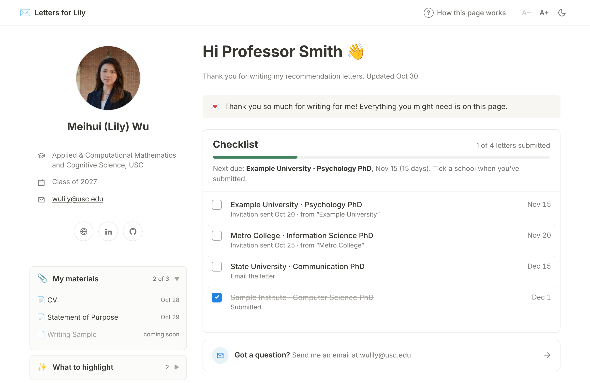
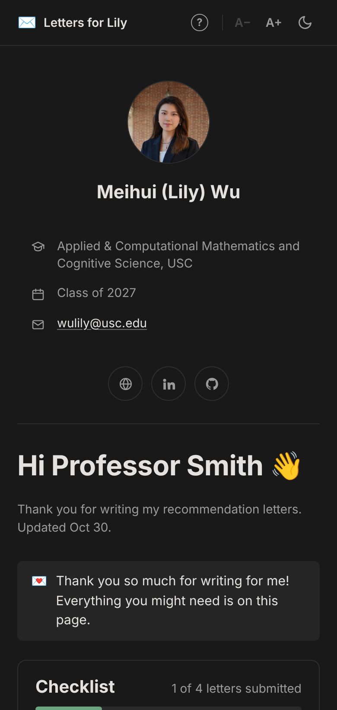
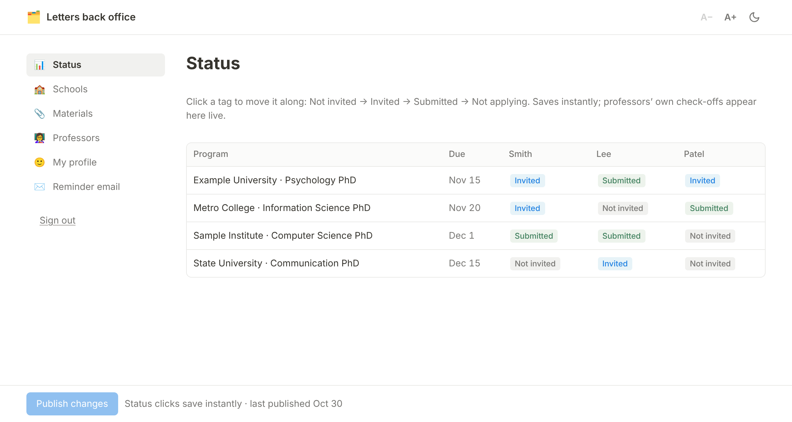

# Recommendation Letter Tracker

A small, free website that keeps your recommenders organized during grad school
applications. Each recommender gets a private link to a calm page that shows
only their schools, deadlines and submission instructions, plus your materials
and the points you hope they will highlight. They can tick a school off when
they submit, and you see it right away in your back office.

No build step, no paid services: plain HTML and JavaScript on GitHub Pages, with
Firebase for storage and sign-in. Set-up takes about fifteen minutes.

Try the demo: https://lilywmh.github.io/rec-letters/?demo

  
  &nbsp;&nbsp;
  

Screenshots use example schools and recommenders.

## What recommenders see

- A short welcome card explaining how the page works, shown on first visit
- Your photo, program, and links, so they remember who you are
- A checklist of their schools, sorted by deadline, with how to submit each one
- Your CV, statements and other materials, and what you'd love them to highlight
- Light and dark mode and adjustable text size

## What you get

- A status table of every school × recommender, updated live when they tick a box
- Editors for schools, deadlines, materials and each recommender's notes
- Ready-to-send reminder emails (friendly check-in, due this week, thank you)
- Private pages: each recommender's page is addressed by a long random token, and
  only your Google account can read the full list

## Use it for your own applications

1. **Copy the repository.** Click *Use this template* (or fork), then turn on
   GitHub Pages under *Settings → Pages → Deploy from a branch → main / root*.
2. **Create a Firebase project** at console.firebase.google.com, add a Web app,
   enable **Firestore** (production mode) and **Authentication → Google**, and add
   `<your-username>.github.io` under *Authentication → Settings → Authorized domains*.
3. **Edit three files:**
   - `firebase-config.js`: paste your Firebase web config and your Google email(s)
   - `firestore.rules`: put the same email(s) in `isOwner()`, then paste the whole
     file into *Firestore → Rules* and publish
   - `site.config.js`: your name, photo, program and links; replace `avatar.jpg`
4. **Load your data.** Open `admin.html` on your site, sign in, and paste a copy of
   `starter.example.json` filled in with your schools and recommenders. Keep that
   file on your computer; it does not belong in the repository.
5. **Send links.** In the back office, open *Professors*, copy each link, and email it.

A step-by-step guide in Chinese is in [`docs/SETUP_zh.md`](docs/SETUP_zh.md).

## Privacy

The repository contains only code. Your schools, recommenders and notes live in
Firestore, protected by `firestore.rules`: anyone with a recommender's exact link
can read that one page and change only its checkmarks; nobody but you can list
pages or read the master data. Material links (e.g. Google Drive) are only as
private as their own sharing settings.

## Files

| file | purpose |
|---|---|
| `index.html` | recommender page |
| `admin.html` | your back office |
| `site.config.js` | your name, photo and links |
| `firebase-config.js` | Firebase project and owner email(s) |
| `firestore.rules` | database access rules |
| `style.css`, `prefs.js` | styling, light/dark mode and text size |
| `starter.example.json` | format for your initial data |

## License

MIT. Made by Meihui (Lily) Wu for her own PhD applications; feel free to use it for yours.
